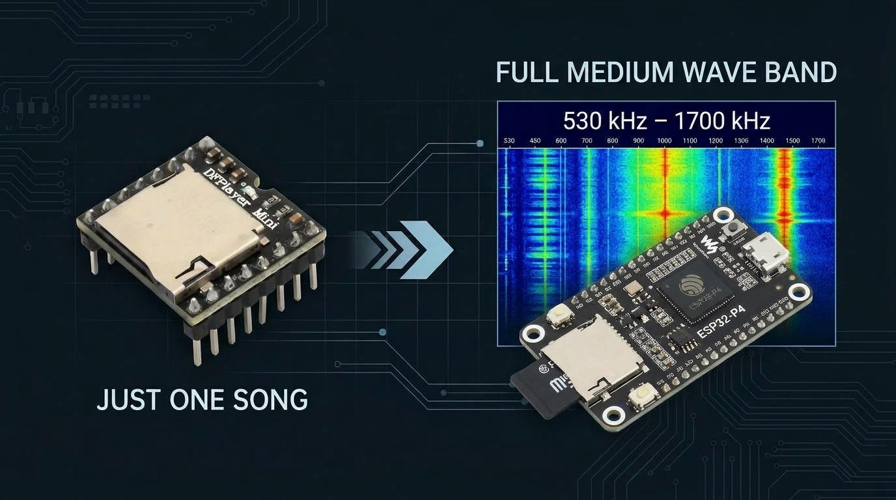

**Language / Sprache:** [Deutsch](README.md) | **English**

---

# COHI-Player-ESP32

Play Cohiradia WAV files from an **SD card** on an ESP32-P4 (rev. 3.x, 400 MHz)
and output them directly as an RF signal via **PARLIO**.
A single ESP32-P4 board acts as a complete player, similar to the well-known MP3 mini players, but for entire
broadcast bands (long wave, medium wave, shortwave).



Boards (currently the Waveshare series): see `main/board.h`. **Up-mixing and sample generation run
entirely on the ESP32 (integer DSP, LUT-based NCO).** Operation is via the serial console.
Ethernet and the PC streamer are **no longer** required.

The project has been **compiled** with IDF v6.1 for `esp32p4`.

## Quick reference

```
sdr> ls -l                      directory listing (with WAV info: fs, shift, next file)
sdr> cd recordings              change directory ("cd" alone = root, ".." works)
sdr> pwd
sdr> play 2019-06-17_20-20-00_1233kHz.wav          play (follows the auxi chain)
sdr> play file.wav 1233.5       override the shift manually (in kHz)
sdr> play list.m3u              playlist: entry → next files (auxi) → next entry
sdr> play loop list.m3u         same as an endless loop (also: play loop file.wav)
sdr> autoplay                   start /autoplay.m3u now (supervision on); autoplay status
sdr> stop
sdr> status                     position, lead, underruns, DSP load, gain
sdr> info file.wav              header + selected PARLIO clock + load estimate
sdr> gain auto | gain 0.5       AGC (target 50 %) or fixed gain (live)
sdr> width 8|16   offset on|off   maxrate <MHz>   cores auto|1|2   (take effect on the next play)
sdr> selftest                   benchmark (cycles/sample) + check of the two-core computation (not during play)
sdr> mount / umount
```

`/` is the root of the SD card.

## Console commands (long version)

Verbatim console output of `help`. The help texts built into the firmware are currently in German;
the table below the listing gives the English equivalents.

```
sdr>  help
help  [<string>] [-v <0|1>]
  Print the summary of all registered commands if no arguments are given,
  otherwise print summary of given command.
      <string>  Name of command
  -v, --verbose=<0|1>  If specified, list console commands with given verbose level

ls 
  Verzeichnis anzeigen: ls [-l] [pfad]  (-l: WAV-Header-Infos)

cd 
  Verzeichnis wechseln: cd [pfad]  (ohne Argument: Wurzel)

pwd 
  aktuelles Verzeichnis

play 
  Wiedergabe: play [loop] <datei.wav|liste.m3u> [shift_kHz]

autoplay 
  autoplay.m3u jetzt starten und Ueberwachung einschalten; autoplay status

stop 
  Wiedergabe stoppen

status 
  Player-Status, Vorsprung, Underruns, DSP-Last

info 
  WAV-Header + PARLIO-Plan anzeigen: info <datei.wav>

gain 
  Verstaerkung: gain auto | gain <0.01..4.0>

width 
  Busbreite: width 8|16

cores 
  Mischer auf 2 Cores: cores auto|1|2

selftest 
  Benchmark + Pruefung Zwei-Core-Bitgleichheit (nicht waehrend play)

offset 
  Offset-Binary: offset on|off

maxrate 
  max. PARLIO-Takt in MHz: maxrate [MHz]

mount 
  SD-Karte mounten

umount 
  SD-Karte aushaengen

sdr>  
```

| Command | Description |
|---|---|
| `ls [-l] [path]` | list a directory (`-l`: WAV header information) |
| `cd [path]` | change directory (no argument: root) |
| `pwd` | print the current directory |
| `play [loop] <file.wav\|list.m3u> [shift_kHz]` | play a WAV file or a playlist; `loop` = endless loop; optional manual shift in kHz |
| `autoplay` | start `autoplay.m3u` now and enable supervision; `autoplay status` |
| `stop` | stop playback |
| `status` | player status, lead, underruns, DSP load |
| `info <file.wav>` | show the WAV header and the PARLIO plan |
| `gain auto \| gain <0.01..4.0>` | AGC or fixed gain |
| `width 8\|16` | bus width |
| `cores auto\|1\|2` | split the mixer across 2 cores |
| `selftest` | benchmark and check of two-core bit-identity (not during play) |
| `offset on\|off` | offset-binary output |
| `maxrate [MHz]` | maximum PARLIO clock in MHz |
| `mount` | mount the SD card |
| `umount` | unmount the SD card |


## Playlists (`play list.m3u`, `play loop list.m3u`) – The RF Disc Jockey

A playlist is a text file on the SD card with **one file per line**:

```
/file_xyz.wav
/Folder1/file_2.wav
/Folder_x/Folder_y/file.wav
subfolder/relative.wav
```

* `/…` is absolute (“`/`” = root of the SD card; `/sdcard/…` is accepted as well); without a leading `/` the path is relative to the folder
  **of the playlist**. `..` and `.` are resolved. Blank lines, `#` comment lines (`#EXTM3U`, `#EXTINF`), CRLF line endings, a UTF-8 BOM and `\` as
  a path separator (Windows) are tolerated. The extensions `.m3u`, `.m3u8`, `.lst` and `.txt` are recognized as playlists.
* **Sequence:** play the entry → if the file names a next file in its `auxi` chunk, that file is played, then its next file, and so on →
  when there is none left, the **next entry** of the list follows. Next files are looked up in the folder of the current file.
  When the list ends, playback ends; with `loop` it starts again at the first line (endless loop).
  Accordingly, `play loop file.wav` repeats a single file together with its chain of next files.
* **Fault tolerant:** missing, damaged or unplayable entries (e.g. a sample rate above `maxrate`) are skipped with a message.
  An endless loop in which not a single file was playable during a whole pass terminates itself. A chain of next files that loops back onto itself
  is aborted (playback continues with the list). If a next file also appears as a list entry, it is played twice (first as part of the chain,
  then as an entry); the list is not de-duplicated.
* **Gapless:** the transition between files and entries takes the same path as the file change within a chain: the next file is analyzed in advance;
  with the same sample rate and the same PARLIO clock there is no restart (phase and filter state carry on); when the rate changes, the remaining
  data is played out and PARLIO is briefly restarted. A different shift (different center frequency) takes effect seamlessly.
  `play list.m3u 1233` overrides the shift for **all** files in the list.
* `status` shows `Playlist 'list.m3u': Eintrag 3/7, Endlosschleife, Durchläufe: 2` (firmware output, in German: entry 3 of 7, endless loop, 2 passes completed).
* Limits: max. 2048 entries, 256 KiB playlist file, paths of up to 159 characters; nested playlists are not resolved.

## Autoplay at power-on (no console needed) – A solution for everyday museum operation

If a file named **`autoplay.m3u`** is present in the root directory of the SD card, it is played automatically after power-on, as an
**endless loop**. The format is that of any playlist (see above, including folders and next files). No console is required.
The file name, the length of the abort window and the autoplay feature itself can be changed in `idf.py menuconfig` under **COHI-Player**.

**Settings travel with the card:** `#COHI` lines in the playlist (ordinary comments to other m3u programs):

```
#EXTM3U
#COHI width=8 offset=on gain=0.6 maxrate=10 cores=auto
#COHI once
/Folder1/file_2.wav
```

| Directive | Effect |
|---|---|
| `width=8\|16` | bus width (like `width`) |
| `offset=on\|off` | offset-binary DAC (like `offset`) |
| `gain=auto\|0.01..4.0` | AGC or fixed gain (like `gain`) |
| `maxrate=1..40` | maximum PARLIO clock in MHz (like `maxrate`) |
| `cores=auto\|1\|2` | mixer on 2 cores (like `cores`) |
| `once` | a single pass only (instead of an endless loop); then stop, no restart |

Separators are spaces, tabs or commas; keys are case-insensitive; multiple lines are allowed, and later entries override earlier ones.
Unknown keys or invalid values are reported on the console and ignored. **Precedence:** firmware default → playlist directives →
later console commands. The directives apply to **every** playlist, including `play list.m3u` (they take effect when the playlist starts and
remain set afterwards until someone changes them via the console or another playlist does).

**Sequence after power-on**

1. The data pins and the clock are set to “silence” **immediately**, before any SD access (the first ≈ 100 ms before the firmware starts cannot be
   influenced by software). The level corresponds to the default format: with `menuconfig → COHI-Player → Offset-Binary` the mid-scale value
   (0x80) is applied, otherwise all pins are low. The playlist directive `offset=` only takes effect after the card has been read.
2. Mount the SD card. If `autoplay.m3u` exists, a 3 s **abort window** follows: “Autoplay: Start in 3 s – beliebige Taste = abbrechen”
   (firmware message: “start in 3 s – any key = abort”). When a terminal is opened, the USB-UART bridge usually resets the board; the abort window
   makes it possible to prevent autoplay right away in that case.
3. Playback then starts. From power-on to the first audio takes about 3 to 6 s.

**The console takes precedence:** the console always runs in parallel (`status`, `stop`, `play` …). After a manual `stop`, `play` or `umount`,
autoplay does **not** restart by itself until the next power-up. `autoplay` (without an argument) restarts it at any time, even if something else is
currently playing; `autoplay status` shows the file, the number of entries, loop/once, and the state of the supervisor.

**Supervision during continuous operation:** if playback ends on its own (card removed, nothing playable …), a supervisor restarts it: delays of 5 s, 10 s,
then 30 s; before each attempt the SD card is remounted. If playback then runs for at least 30 s, the delays start again at 5 s. With `#COHI once` there is
no restart. A crash (chip reset) leads back into autoplay. The player **only reads and never writes** to the card:
the power supply may be unplugged at any time without endangering the file system.

Not included (planned for a later stage): a user LED for status indication and a button for switching between several playlists.
For now, feedback is provided only via the UART messages.

## What happens on `play`

1. **WAV header** (`wav_info.c`): `fmt` → sample rate, 16-bit stereo I/Q;
   `auxi` → name of the next file (offset 68, 96 bytes, as in the COHIRADIAStreamer) and center frequency (offset 32);
   shift frequency from the file name (“…1233kHz…”), with the `auxi` center frequency as a fallback.
   A Windows path in `auxi` is reduced to the file name; the next file is looked up in the same folder.
2. **Select the rate** (`sdr_plan.c`), see the next section.
3. **DSP** (`sdr_dsp.c`), per I/Q sample of the file:
   gain/AGC → half-band interpolator ×2 → (HQ: second half-band ×2) → linear ramp ×(N/4 or N/2)
   → **LUT-based NCO** (4096 entries, 32-bit phase accumulator) → `I·cos − Q·sin` → 8/16 bit.
4. **Output** into an 8 MB loop ring in PSRAM that PARLIO reads endlessly via DMA (as in the previous project).
5. **File change**: same rate → gapless, only the phase increment changes (the carrier stays phase-continuous);
   different rate → the remainder is played out and PARLIO restarts briefly.

## “Always 4·fs?” – Automatic choice of the resampling rate by the ESP32 (`sdr_plan`)

4·fs? **Yes as a lower bound, but not always sufficient.** With Fs_out = 4·fs the carrier lies in the first Nyquist band only
if `|fc| + fs/2 < Fs_out/2`, i.e. at 250 ksps only up to approx. 375 kHz. A medium-wave recording
(e.g. 1233 kHz, fs = 250 k) needs at least ~3.4 MS/s. The planner therefore picks the **smallest N = 4, 8, 12, …**
for which the following holds:

* `Fs_out = N·fs` is an **exact integer divisor of 160 MHz** (the PARLIO source clock; no fractional divider means no clock jitter and an
  exact playback speed). For 250 k: N ∈ {4, 8, 16, 20, 32, 40, …}; for 1.25 M: N ∈ {4, 8, 16, 32}.
* `Fs_out ≥ 2.5 · (|fc| + fs/2)`. This leaves room for a realistic analog reconstruction filter.
* `Fs_out ≤ maxrate` (default 10 MHz, see the CPU limits).

If this is not sufficient, the signal currently runs in **alias/image mode** (higher Nyquist zone). The NCO then simply wraps modulo 2³²,
and the wanted signal is present as an image at `fc`. This brings sinc attenuation and many images; **a band-pass filter is required**.
The player issues a warning in this case. Odd rates that do not yield an exact divisor
run with a fractional divider (warning, jitter).

As in the `DspWorker` of the COHIRADIAStreamer, the NCO is a LUT. Because `fc` is in general not a multiple of `fs/4`,
there is no ±1/0 mixing pattern; instead, a phase accumulator plus a 4096-point sine/cosine table is used (theoretical phase-truncation spur at 12 bits
≈ −72 dBc; `SDR_LUT_BITS` in `sdr_dsp.h` can be increased).

## Feasibility and load on the ESP32-P4 (rev. 3.x, 400 MHz)

Instruction counts from the generated RISC-V code (`riscv32-esp-elf-gcc` 15, `-O3`): mixer **19 instructions per output sample**,
HQ filter approx. 203 and FAST filter approx. 97 instruction equivalents per input sample, 1.2 cycles per instruction.
The model was checked and calibrated against **measurements**: HQ 250 ksps → 1 MS/s: measured 21 % (model 21 %);
FAST 1.25 Msps → 5 MS/s: measured 65 % (model now calibrated).
`selftest` measures the cycles per sample on your own board.

| fs | fc | N | PARLIO | Mode | 1 core | 2 cores (core 1 / core 0) |
|---|---|---|---|---|---|---|
| 250 k | 531 kHz | 8 | 2 MHz | HQ | 27 % | 15 % / 11 % |
| 250 k | 1233 kHz | 16 | 4 MHz | HQ | 38 % | 19 % / 19 % |
| 250 k | 3.95 MHz | 40 | 10 MHz | HQ | 72 % | 36 % / 36 % |
| 250 k | 6.09 MHz, `maxrate 10` | 40 | 10 MHz | HQ | 72 % (**alias image at 3.91 MHz**) | 36 % / 36 % |
| 250 k | 6.09 MHz, `maxrate 16` | 64 | 16 MHz | HQ | **106 %** | 53 % / 53 % |
| 500 k | 1233 kHz | 8 | 4 MHz | HQ | 53 % | 30 % / 23 % |
| 625 k | 1 MHz | 8 | 5 MHz | FAST | 47 % | 23 % / 23 % |
| 1.25 M | 1.25 MHz | 4 | 5 MHz | FAST | 65 % (measured) | 36 % / 28 % |
| 1.25 M | 1.8 MHz | 8 | 10 MHz | FAST | **93 %** | 47 % / 47 % |
| 2.5 M | 1 MHz | 4 | 10 MHz | FAST | **130 %** | 73 % / 57 % |

* **One core is enough** for all cases up to approx. 80 %: all 250 k recordings up to a carrier of approx. 4 MHz, 500/625 ksps, and 1.25 Msps at N=4.
* **Two cores are required** if a carrier above approx. 4 MHz is to be generated **genuinely** in the first Nyquist band
  (e.g. 6.09 MHz: 16 MS/s, `maxrate 16`), for 1.25 Msps with N=8, or for 2.5 Msps. Without 2 cores, 6.09 MHz runs only as an
  alias/image signal at 3.91 MHz (band-pass filter required, level attenuated by sinc; this practically always works without any further
  tuning of the `sdkconfig` values).
* **Limits**: SD read throughput ≈ 10 MB/s ≈ 2.5 Msps; pixel clock ≤ 20 MHz with 2 cores (`maxrate`).

### Two cores (`cores auto|1|2`)

Core 1 computes gain/AGC, the half-bands and part of the mixer; core 0 computes the rest of the mixer
(the split is chosen so that both cores are equally loaded). `cores auto` (default) enables the second half only
if the estimated load would be ≥ 85 %, so all settings that already work remain unchanged.
The split is **bit-identical** to the single-core computation (host test `test/host_split.c`: 420 cases, all modes).
**`selftest`** computes 2× 200 blocks in one piece and split across the two cores, and compares them byte by byte. If it reports “bit-identisch” (bit-identical), `cores 2` is cleared for use; otherwise please leave it at `cores 1`.

### FAST vs. HQ

Below 600 ksps: two half-bands (×4) and a ramp; the half-band image rejection for signals up to approx. 0.25·fs is better than −57 dB (host simulation).
From 600 ksps: one half-band (×2) plus a ramp, because the images then lie ≥ 1.5·fs (≥ 900 kHz) away from the carrier
and the reconstruction filter removes them. At the extreme band edge (> 0.35·fs) the rejection is only approx. 20 dB there.
Measured (host simulation, baseband tones, FFT): see `test/`.

Plain sample repetition ×M would have produced mirror images only approx. 23–36 dB below the carrier, directly next to
the wanted band, for `fc ≈ k·2fs`. Hence the linear ramp: the same scenario now sits at −45…−70 dB.

## Files of 2 GiB and above, and the file change

Cohiradia recordings are split at approx. 2 GiB (e.g. `AM1_…_1_…wav` = 2,146,435,296 bytes, the next file 2,147,483,655 bytes).
On the ESP32-P4, `long` and `off_t` are **32-bit signed**: `fseek(SEEK_END)`/`ftell` fail for files ≥ 2 GiB
(the symptom was “keine RIFF/WAVE-Datei” (not a RIFF/WAVE file) exactly at the transition to the next file, although the header was fine).
The file size is therefore taken from `stat()` and read as an unsigned 32-bit number (FAT32: max. 4 GiB − 1); file offsets ≥ 2 GiB are never
seeked to, and the data is read sequentially. exFAT files > 4 GiB remain inaccessible with a 32-bit `off_t`.

For a gapless transition, the reader analyzes the header of the next file as soon as ≤ 4 MB of the current file remain;
at the end of the file only `open` and `lseek` are left. With the same sample rate and the same shift, the output continues without a PARLIO restart
(phase and filter state are preserved). Note: the payload of the next file begins with an embedded second copy of the
RIFF header (216 bytes ≈ 54 I/Q samples of noise at the start of the file); this is harmless and identical in the COHIRADIAStreamer.

## Synchronization without querying the DMA position

In loop mode the DMA read pointer cannot be queried. The IDF 6.1 driver offers `on_buffer_switched`
(ping-pong), but re-linking the descriptor chain takes place without a handshake with the DMA.
Instead: the CPU clock and the PARLIO clock are derived from the same crystal, so exactly
`played(t) = (t − t0) · Fs_out` holds. The write pointer is regulated to a lead of approx. 80–100 ms (`esp_timer`,
1 ms tick). If the lead falls below 1 ms, stale ring content is overwritten with silence and an underrun is counted;
stale data is never played back. `status` shows the lead and the underruns.

## Hardware (from the Waveshare schematics)

* Data bus/clock on the pin header: taken from `parlioSDR` (`esp32_p4_*.h`, selection in `board.h`).
* SD (SDMMC slot 0, 4-bit): D0–D3 = GPIO 39–42, CLK = 43, CMD = 44; pull-ups on LDO_VO4 → the **on-chip LDO channel 4** is enabled in the code.
* **On all five boards examined (ETH, NANO, WIFI6-DEV-KIT, WIFI6-POE-ETH, Module-DEV-KIT), GPIO45 is the gate of the P-FET
  that switches the SD card supply** (10 k to GND = card ON, high = card OFF). It must therefore **not be a PARLIO pin**, otherwise the
  data stream would switch the card on and off. The code explicitly drives GPIO45 to “ON” when mounting and rejects `width`/`play`
  if a PARLIO pin would lie on GPIO45, GPIO39–44 or the console (GPIO37/38).
* Consequence for the headers from `parlioSDR`:

| Board | Original assignment | Changed here to |
|---|---|---|
| ETH | no GPIO45 | unchanged |
| NANO | **SD3 = GPIO45** (already in 8-bit mode) | **SD3 = GPIO0** (header P2 pin 6) |
| WIFI6-DEV-KIT | SD15 = GPIO45 (16-bit only) | SD15 = GPIO46 (header P6 pin 36) |
| WIFI6-POE-ETH | SD15 = GPIO45 (16-bit only) | unchanged, `width 16` is rejected (8-bit is fine) |
| Module-DEV-KIT | SD8 = GPIO45 (16-bit only) | unchanged, `width 16` is rejected (8-bit is fine) |

  According to the schematics, the replacement pins GPIO0 (NANO) and GPIO46 (WIFI6-DEV-KIT) are located on the header and are not used otherwise;
  please verify them against the exact board and revision in use before first use. No replacement pin has been verified for POE-ETH and Module-DEV-KIT.
* File system: FAT/exFAT with long file names. 16-bit I/Q WAV (other formats are rejected with a message).

## Building

```
idf.py set-target esp32p4
idf.py build flash monitor
```

`sdkconfig.defaults`: 400 MHz (`ESP32P4_REV_MIN_300`; on rev < 3, 360 MHz is required), PSRAM hex 80 MHz as before,
`-O2`, FreeRTOS tick 1000 Hz, FATFS LFN. The DSP core is built with `-O3` so that the filter loops are unrolled.
The filter sizes can be set via `-DSDR_HB1_K=…` / `-DSDR_HB2_K=…` (number of interpolation points per half-band).

## Host tests (without hardware)

```
python3 test/make_test_wav.py          # Cohiradia-like WAVs with auxi + next file
gcc -O3 -o test/host_dsp test/host_dsp.c main/sdr_dsp.c -lm
python3 test/analyze.py                # FFT: carrier, images, mirror images, spurs
python3 test/test_len.py               # output length = n·N for all modes
gcc -O2 -o test/host_split test/host_split.c main/sdr_dsp.c -lm && ./test/host_split   # 2-core split is bit-identical
gcc -o test/host_table test/host_table.c main/sdr_plan.c main/sdr_dsp.c -lm && ./test/host_table   # load table
gcc -o test/host_bigfile test/host_bigfile.c main/wav_info.c && ./test/host_bigfile [file.wav ...]   # file size >= 2 GiB (32-bit off_t)
gcc -o test/host_playlist test/host_playlist.c main/playlist.c && ./test/host_playlist   # playlist parser + sequencing (chain, loop, error cases)
gcc -o test/host_cohi test/host_cohi.c main/cohi_cfg.c main/playlist.c && ./test/host_cohi   # #COHI directives
gcc -o test/host_autoplay test/host_autoplay.c main/autoplay_logic.c && ./test/host_autoplay   # supervisor: delays, once, immediate start
gcc -o test/host_misc test/host_misc.c main/sdr_plan.c main/wav_info.c -lm && ./test/host_misc
```
