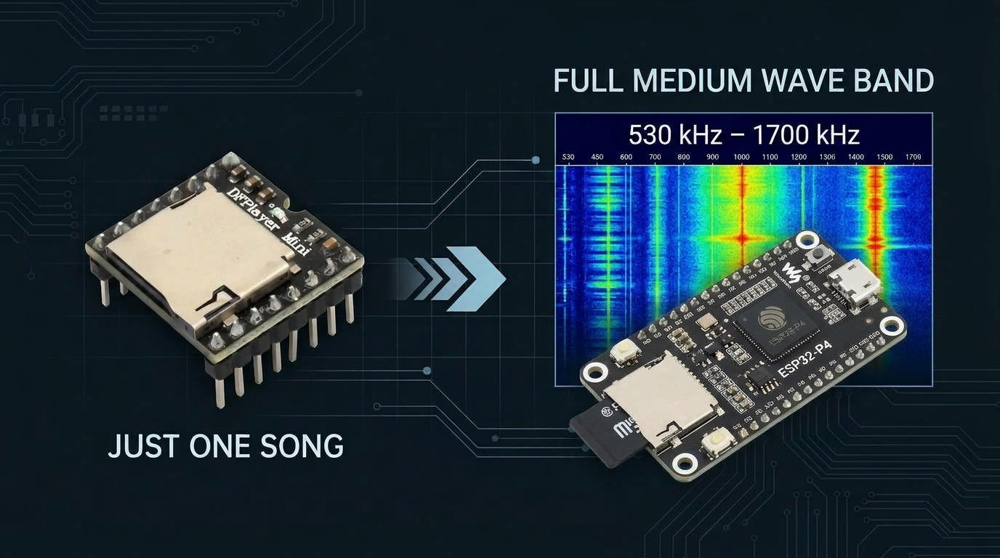

# COHI-Player-ESP32

Cohiradia-WAV-Dateien von der **SD-Karte** mit einem ESP32-P4 ( Rev 3.x, 400 MHz)
direkt als HF-Signal über **PARLIO** ausgeben. 
Ein ESP32-P4 Board als kompletter Player, ähnlich der bekannten MP3-Mini-Player, nur für ein komplette
Rundfunkband (Langwelle, Mittelwelle, Kurzwelle).



Boards (z.Zt. Waveshare-Serie) siehe `main/board.h`. Das **Hochmischen und die Samplebildung laufen
vollständig auf dem ESP32 (Integer-DSP, LUT-NCO)**. Bedienung über die serielle Konsole.
Ethernet und der PC-Streamer werden **nicht** mehr benötigt.

Das Projekt wurde mit IDF v6.1 für `esp32p4` **kompiliert** .

## Bedienung Kurzübersicht

```
sdr> ls -l                      Verzeichnis (mit WAV-Infos: fs, Shift, Folgedatei)
sdr> cd aufnahmen               Verzeichnis wechseln ("cd" allein = Wurzel, ".." geht)
sdr> pwd
sdr> play 2019-06-17_20-20-00_1233kHz.wav          Wiedergabe (folgt der auxi-Kette)
sdr> play datei.wav 1233.5      Shift manuell in kHz überschreiben
sdr> play liste.m3u             Playlist: Eintrag → Folgedateien (auxi) → nächster Eintrag
sdr> play loop liste.m3u        dasselbe als Endlosschleife (auch: play loop datei.wav)
sdr> autoplay                   /autoplay.m3u jetzt starten (Überwachung an); autoplay status
sdr> stop
sdr> status                     Position, Vorsprung, Underruns, DSP-Last, Gain
sdr> info datei.wav             Header + gewählter PARLIO-Takt + Lastabschätzung
sdr> gain auto | gain 0.5       AGC (Ziel 50 %) oder fester Gain (live)
sdr> width 8|16   offset on|off   maxrate <MHz>   cores auto|1|2   (wirken ab dem nächsten play)
sdr> selftest                   Benchmark (Takte/Sample) + Prüfung der Zwei-Core-Rechnung (nicht während play)
sdr> mount / umount
```

`/` ist die Wurzel der SD-Karte.

## Kommandos in der Konsole (Langversion)

```
sdr>  help
help  [<string>] [-v <0|1>]
  Print the summary of all registered commands if no arguments are given,
  otherwise print summary of given command.
      <string>  Name of command
  -v, --verbose=<0|1>  If specified, list console commands with given verbose level

ls 
  Verzeichnis anzeigen: ls [-l] [pfad]  (-l: WAV-Header-Infos)

cd 
  Verzeichnis wechseln: cd [pfad]  (ohne Argument: Wurzel)

pwd 
  aktuelles Verzeichnis

play 
  Wiedergabe: play [loop] <datei.wav|liste.m3u> [shift_kHz]

autoplay 
  autoplay.m3u jetzt starten und Ueberwachung einschalten; autoplay status

stop 
  Wiedergabe stoppen

status 
  Player-Status, Vorsprung, Underruns, DSP-Last

info 
  WAV-Header + PARLIO-Plan anzeigen: info <datei.wav>

gain 
  Verstaerkung: gain auto | gain <0.01..4.0>

width 
  Busbreite: width 8|16

cores 
  Mischer auf 2 Cores: cores auto|1|2

selftest 
  Benchmark + Pruefung Zwei-Core-Bitgleichheit (nicht waehrend play)

offset 
  Offset-Binary: offset on|off

maxrate 
  max. PARLIO-Takt in MHz: maxrate [MHz]

mount 
  SD-Karte mounten

umount 
  SD-Karte aushaengen

sdr>  
```


## Playlists (`play liste.m3u`, `play loop liste.m3u`) - Der RF Discjockey.

Eine Playlist ist eine Textdatei auf der SD-Karte, **eine Datei pro Zeile**:

```
/datei_xyz.wav
/Ordner1/datei_2.wav
/Ordner_x/Ordner_y/datei.wav
unterordner/relativ.wav
```

* `/…` ist absolut („`/`“ = Wurzel der SD-Karte, auch `/sdcard/…` wird akzeptiert); ohne führenden `/` relativ zum Ordner **der Playlist**.
  `..` und `.` werden aufgelöst. Leerzeilen, `#`-Kommentarzeilen (`#EXTM3U`, `#EXTINF`), CRLF-Zeilenenden, UTF-8-BOM und `\` als
  Trenner (Windows) werden toleriert. Als Playlist gelten die Endungen `.m3u`, `.m3u8`, `.lst`, `.txt`.
* **Ablauf:** Eintrag spielen → hat die Datei im `auxi`-Chunk eine Folgedatei, wird diese gespielt, und deren Folgedatei usw. →
  gibt es keine mehr, kommt der **nächste Eintrag** der Liste. Folgedateien werden im Ordner der jeweils aktuellen Datei gesucht.
  Ist die Liste zu Ende, endet die Wiedergabe; mit `loop` beginnt sie wieder bei der ersten Zeile (Endlosschleife).
  `play loop datei.wav` wiederholt entsprechend eine einzelne Datei samt Folgedateien.
* **Fehlertolerant:** fehlende, defekte oder nicht spielbare Einträge (z. B. Rate über `maxrate`) werden mit einer Meldung übersprungen.
  Eine Endlosschleife, in der in einem ganzen Durchlauf keine einzige Datei spielbar war, beendet sich selbst. Eine Folgedatei-Kette,
  die auf sich selbst zurückläuft, wird abgebrochen (weiter mit der Liste). Taucht eine Folgedatei zusätzlich als Listeneintrag auf, wird sie
  zweimal gespielt (erst in der Kette, dann als Eintrag), die Liste wird nicht dedupliziert.
* **Nahtlos:** Der Übergang zwischen Dateien und Einträgen läuft über denselben Pfad wie der Dateiwechsel in einer Kette: Die nächste Datei
  wird vorab ausgewertet; bei gleicher Samplerate und gleichem PARLIO-Takt gibt es keinen Neustart (Phase und Filter laufen weiter), bei einem
  Wechsel der Rate wird der Rest ausgespielt und PARLIO kurz neu gestartet. Ein anderer Shift (andere Mittenfrequenz) wirkt nahtlos.
  `play liste.m3u 1233` überschreibt den Shift für **alle** Dateien der Liste.
* `status` zeigt `Playlist 'liste.m3u': Eintrag 3/7, Endlosschleife, Durchläufe: 2`.
* Grenzen: max. 2048 Einträge, 256 KiB Playlistdatei, Pfade bis 159 Zeichen; verschachtelte Playlists werden nicht aufgelöst.

## Autoplay beim Einschalten (ohne Konsole) - Lösung für den Museumsalltag.

Liegt auf der SD-Karte im Wurzelverzeichnis eine Datei **`autoplay.m3u`**, wird sie nach dem Einschalten automatisch abgespielt, als
**Endlosschleife**. Format wie jede Playlist (siehe oben, Ordner und Folgedateien inklusive). Es ist keine Konsole nötig.
Der Dateiname, die Länge des Abbruchfensters und der Autoplay selbst lassen sich in `idf.py menuconfig` unter **COHI-Player** ändern.

**Einstellungen reisen mit der Karte:** `#COHI`-Zeilen in der Playlist (für andere m3u-Programme normale Kommentare):

```
#EXTM3U
#COHI width=8 offset=on gain=0.6 maxrate=10 cores=auto
#COHI once
/Ordner1/datei_2.wav
```

| Direktive | Wirkung |
|---|---|
| `width=8\|16` | Busbreite (wie `width`) |
| `offset=on\|off` | Offset-Binary-DAC (wie `offset`) |
| `gain=auto\|0.01..4.0` | AGC bzw. fester Gain (wie `gain`) |
| `maxrate=1..40` | max. PARLIO-Takt in MHz (wie `maxrate`) |
| `cores=auto\|1\|2` | Mischer auf 2 Cores (wie `cores`) |
| `once` | nur ein Durchlauf (statt Endlosschleife); danach Ende, kein Neustart |

Trenner sind Leerzeichen, Tab oder Komma; die Schlüssel sind groß-/kleinschreibungsunabhängig; mehrere Zeilen sind erlaubt, später überschreibt
früher. Unbekannte Schlüssel oder ungültige Werte werden in der Konsole gemeldet und ignoriert. **Rangfolge:** Firmware-Standard → Direktiven der
Playlist → spätere Konsolenbefehle. Die Direktiven gelten für **jede** Playlist, auch bei `play liste.m3u` (sie wirken beim Start der Playlist und
bleiben danach gesetzt, bis sie jemand per Konsole oder eine andere Playlist ändert).

**Ablauf nach dem Einschalten**

1. Die Datenpins und der Takt werden **sofort** auf „Stille“ gelegt, noch vor dem SD-Zugriff (die ersten ca. 100 ms bis zum Start der Firmware
   kann die Software nicht beeinflussen). Der Pegel entspricht dem Standardformat: mit `menuconfig → COHI-Player → Offset-Binary` liegt die Mitte
   (0x80) an, sonst alles low. Die Playlist-Direktive `offset=` greift erst nach dem Lesen der Karte.
2. SD mounten. Gibt es `autoplay.m3u`, folgt ein **Abbruchfenster** von 3 s: „Autoplay: Start in 3 s – beliebige Taste = abbrechen“.
   Beim Öffnen eines Terminals setzt die USB-UART-Brücke das Board meist zurück; so lässt sich der Autoplay dann sofort verhindern.
3. Danach startet die Wiedergabe. Vom Einschalten bis zum ersten Ton vergehen etwa 3 bis 6 s.

**Vorrang der Konsole:** Die Konsole läuft immer parallel (`status`, `stop`, `play` ...). Nach einem manuellen `stop`, `play` oder `umount` startet der
Autoplay **nicht** von selbst neu, bis zum nächsten Einschalten. `autoplay` (ohne Argument) startet ihn jederzeit neu, auch wenn gerade etwas anderes
läuft; `autoplay status` zeigt Datei, Einträge, Schleife/einmal und den Zustand der Überwachung.

**Überwachung im Dauerbetrieb:** Endet die Wiedergabe von selbst (Karte gezogen, nichts spielbar ...), startet ein Überwacher sie neu: Pausen 5, 10, danach 30 s;
vor jedem Versuch wird die SD-Karte neu gemountet. Läuft die Wiedergabe danach mindestens 30 s, beginnen die Pausen wieder bei 5 s. Mit `#COHI once` gibt es
keinen Neustart. Ein Absturz (Neustart des Chips) führt wieder in den Autoplay. Der Player **liest nur und schreibt nie** auf die Karte:
Das Netzteil darf jederzeit abgezogen werden, ohne das Dateisystem zu gefährden.

Nicht enthalten (spätere Ausbaustufe): Benutzer-LED zur Statusanzeige und eine Taste zum Umschalten zwischen mehreren Playlists.
Rückmeldung gibt es bisher nur über die UART-Meldungen.

## Was passiert beim `play`

1. **WAV-Header** (`wav_info.c`): `fmt` → Samplerate, 16-Bit-Stereo-I/Q;
   `auxi` → Name der Folgedatei (Offset 68, 96 Byte, wie im COHIRADIAStreamer) und Mittenfrequenz (Offset 32);
   Shift-Frequenz aus dem Dateinamen („…1233kHz…“), Fallback `auxi`-Mittenfrequenz.
   Ein Windows-Pfad in `auxi` wird auf den Dateinamen reduziert; die Folgedatei wird im selben Ordner gesucht.
2. **Rate wählen** (`sdr_plan.c`), siehe nächster Abschnitt.
3. **DSP** (`sdr_dsp.c`), pro I/Q-Sample der Datei:
   Gain/AGC → Halbband-Interpolator ×2 → (HQ: zweites Halbband ×2) → lineare Rampe ×(N/4 bzw. N/2)
   → **LUT-NCO** (4096 Einträge, 32-Bit-Phasenakkumulator) → `I·cos − Q·sin` → 8/16 Bit.
4. **Ausgabe** in einen 8-MB-Loop-Ring im PSRAM, den PARLIO per DMA endlos liest (wie im bisherigen Projekt).
5. **Dateiwechsel**: gleiche Rate → nahtlos, nur das Phaseninkrement ändert sich (der Träger bleibt phasenstetig);
   andere Rate → Rest wird ausgespielt, PARLIO startet kurz neu.

##  „immer 4·fs durch sdr_plan ? - Automatische Wahl des Resampling durch den ESP32 ! “

4·fs? **Ja als Untergrenze, aber nicht immer ausreichend.** Mit Fs_out = 4·fs liegt der Träger nur im ersten Nyquistband,
wenn `|fc| + fs/2 < Fs_out/2`, also bei 250 ksps nur bis ca. 375 kHz. Eine Mittelwellenaufnahme
(z. B. 1233 kHz, fs = 250 k) braucht mindestens ~3,4 MS/s. Der Planer nimmt daher das **kleinste N = 4, 8, 12, …**,
für das gilt:

* `Fs_out = N·fs` ist ein **exakter ganzzahliger Teiler von 160 MHz** (PARLIO-Quelltakt, kein Bruchteiler = kein Taktjitter,
  Abspielgeschwindigkeit exakt). Für 250 k: N ∈ {4, 8, 16, 20, 32, 40, …}; für 1,25 M: N ∈ {4, 8, 16, 32}.
* `Fs_out ≥ 2,5 · (|fc| + fs/2)`. Damit bleibt Platz für einen realistischen analogen Rekonstruktionsfilter.
* `Fs_out ≤ maxrate` (Standard 10 MHz, siehe CPU-Grenzen).

Reicht das nicht, läuft das Signal aktuell im **Alias-/Bild-Betrieb** (höhere Nyquistzone). Der NCO wickelt dann einfach modulo 2³²,
das Nutzsignal liegt als Bild bei `fc` vor. Dabei gibt es sinc-Dämpfung und viele Bilder, **ein Bandpass ist nötig**.
Der Player warnt in diesem Fall. Ungerade Raten, die keinen exakten Teiler ergeben,
laufen mit Bruchteiler (Warnung, Jitter).

Der NCO ist wie im `DspWorker` des COHIRADIAStreamer eine LUT. Weil `fc` im Allgemeinen kein Vielfaches von `fs/4` ist,
gibt es kein ±1/0-Mischmuster, sondern Phasenakkumulator + 4096-Punkt-Sinus/Cosinus-Tabelle (theoretischer Phasenrunden-Spur bei 12 Bit ca. −72 dBc; `SDR_LUT_BITS` in `sdr_dsp.h` erhöhbar).

## Machbarkeit und Last auf dem ESP32-P4 (Rev 3.x, 400 MHz)

Instruktionszahlen aus dem erzeugten RISC-V-Code (`riscv32-esp-elf-gcc` 15, `-O3`): Mischer **19 Instr./Ausgangssample**,
HQ-Filter ca. 203, FAST-Filter ca. 97 Instr.-Äquivalente je Eingangssample, 1,2 Takte/Instruktion.
Das Modell wurde an **Messwerten** geprüft/kalibriert: HQ 250 ksps → 1 MS/s: gemessen 21 % (Modell 21 %);
FAST 1,25 Msps → 5 MS/s: gemessen 65 % , Modell jetzt kalibriert).
`selftest` misst die Takte/Sample auf dem eigenen Board.
| fs | fc | N | PARLIO | Modus | 1 Core | 2 Cores (Core 1 / Core 0) |
|---|---|---|---|---|---|---|
| 250 k | 531 kHz | 8 | 2 MHz | HQ | 27 % | 15 % / 11 % |
| 250 k | 1233 kHz | 16 | 4 MHz | HQ | 38 % | 19 % / 19 % |
| 250 k | 3,95 MHz | 40 | 10 MHz | HQ | 72 % | 36 % / 36 % |
| 250 k | 6,09 MHz, `maxrate 10` | 40 | 10 MHz | HQ | 72 % (**Alias-Bild bei 3,91 MHz**) | 36 % / 36 % |
| 250 k | 6,09 MHz, `maxrate 16` | 64 | 16 MHz | HQ | **106 %** | 53 % / 53 % |
| 500 k | 1233 kHz | 8 | 4 MHz | HQ | 53 % | 30 % / 23 % |
| 625 k | 1 MHz | 8 | 5 MHz | FAST | 47 % | 23 % / 23 % |
| 1,25 M | 1,25 MHz | 4 | 5 MHz | FAST | 65 % (gemessen) | 36 % / 28 % |
| 1,25 M | 1,8 MHz | 8 | 10 MHz | FAST | **93 %** | 47 % / 47 % |
| 2,5 M | 1 MHz | 4 | 10 MHz | FAST | **130 %** | 73 % / 57 % |

* **Ein Core reicht** für alle Fälle bis ca. 80 %: alle 250-k-Aufnahmen bis ca. 4 MHz Träger, 500/625 ksps und 1,25 Msps bei N=4.
* **Zwei Cores sind nötig**, wenn ein Träger oberhalb von ca. 4 MHz **echt** im ersten Nyquistband erzeugt werden soll
  (z. B. 6,09 MHz: 16 MS/s, `maxrate 16`), bei 1,25 Msps mit N=8 oder bei 2,5 Msps. Ohne 2 Cores läuft 6,09 MHz nur als
  Alias-/Bild-Signal bei 3,91 MHz (Bandpass nötig, Pegel durch sinc gedämpft, läuft praktisch immer ohne weitere Optimierungen der Werte der sdkconfig).
* **Grenzen**: SD-Lesedurchsatz ≈ 10 MB/s ≈ 2,5 Msps; Pixeltakt ≤ 20 MHz bei 2 Cores (`maxrate`).

### Zwei Cores (`cores auto|1|2`)

Core 1 rechnet Gain/AGC und Halbbänder und einen Teil des Mischers, Core 0 den Rest des Mischers
(Aufteilung so gewählt, dass beide gleich ausgelastet sind). `cores auto` (Standard) schaltet die zweite Hälfte nur zu,
wenn die geschätzte Last ≥ 85 % wäre, alle bisher laufenden Einstellungen bleiben also unverändert.
Die Aufteilung ist **bit-identisch** zur Einzel-Core-Rechnung (Host-Test `test/host_split.c`: 420 Fälle, alle Modi).
**`selftest`** rechnet 2× 200 Blöcke einteilig und geteilt und vergleicht Byte für Byte. Meldet er „bit-identisch“, ist `cores 2` freigegeben, sonst bitte `cores 1` lassen.

### FAST vs. HQ

Unter 600 ksps: zwei Halbbänder (×4) und Rampe, danach Halbband-Bildunterdrückung für Signale bis ca. 0,25·fs besser als −57 dB (Host-Simulation).
Ab 600 ksps: ein Halbband (×2) plus Rampe, weil die Bilder dann ≥ 1,5·fs (≥ 900 kHz) vom Träger entfernt liegen
und der Rekonstruktionsfilter sie entfernt. Am äußersten Bandrand (> 0,35·fs) ist die Unterdrückung dort nur ca. 20 dB.
Gemessen (Host-Simulation, Töne im Basisband, FFT): siehe `test/`.

Eine reine Sample-Wiederholung ×M hätte bei `fc ≈ k·2fs` Spiegelbilder nur ca. 23–36 dB unter dem Träger direkt neben
dem Nutzband erzeugt. Deshalb die lineare Rampe: das gleiche Szenario liegt jetzt bei −45…−70 dB.

## Dateien ab 2 GiB und Dateiwechsel

Cohiradia-Aufnahmen werden bei ca. 2 GiB geteilt (z. B. `AM1_…_1_…wav` = 2.146.435.296 Byte, die Folgedatei 2.147.483.655 Byte).
Auf dem ESP32-P4 sind `long` und `off_t` **32 Bit mit Vorzeichen**: `fseek(SEEK_END)`/`ftell` scheitern bei Dateien ≥ 2 GiB
(das Symptom war „keine RIFF/WAVE-Datei“ genau beim Übergang zur Nachfolgedatei, obwohl der Header in Ordnung ist).
Die Dateigröße kommt deshalb aus `stat()` und wird als vorzeichenlose 32-Bit-Zahl gelesen (FAT32: max. 4 GiB − 1); es werden nie
Dateioffsets ≥ 2 GiB angefahren, die Daten werden sequentiell gelesen. exFAT-Dateien > 4 GiB bleiben mit 32-Bit-`off_t` unzugänglich.

Für einen lückenlosen Übergang wertet der Reader den Header der Folgedatei schon aus, sobald noch ≤ 4 MB der aktuellen Datei übrig sind;
am Dateiende bleiben nur `open` und `lseek`. Bei gleicher Samplerate und gleichem Shift läuft die Ausgabe ohne PARLIO-Neustart weiter
(Phase und Filterzustand bleiben erhalten). Hinweis: Die Nutzdaten der Nachfolgedatei beginnen mit einer eingebetteten zweiten
RIFF-Kopfkopie (216 Byte ≈ 54 I/Q-Samples Rauschen am Dateianfang); das ist harmlos und im COHIRADIAStreamer genauso.

## Synchronisation ohne DMA-Positionsabfrage

Im Loop-Modus lässt sich der DMA-Lesezeiger nicht abfragen. Der IDF-6.1-Treiber bietet `on_buffer_switched`
(Ping-Pong), aber das Umhängen der Descriptor-Kette läuft ohne Handshake mit dem DMA.
Stattdessen: CPU-Takt und PARLIO-Takt kommen vom selben Quarz, also gilt exakt
`gespielt(t) = (t − t0) · Fs_out`. Der Schreibzeiger wird auf ca. 80–100 ms Vorsprung geregelt (`esp_timer`,
1-ms-Tick). Fällt der Vorsprung unter 1 ms, wird veraltetes Ringmaterial mit Stille überschrieben und ein Underrun gezählt,
es wird nie Altmaterial abgespielt. `status` zeigt Vorsprung und Underruns.

## Hardware (aus den Waveshare-Schaltplänen)

* Datenbus/Takt auf dem Pin-Header: aus `parlioSDR` (`esp32_p4_*.h`, Auswahl in `board.h`).
* SD (SDMMC Slot 0, 4 Bit): D0–D3 = GPIO 39–42, CLK = 43, CMD = 44; Pull-ups an LDO_VO4 → **on-chip-LDO Kanal 4** wird im Code aktiviert.
* **GPIO45 ist auf allen fünf geprüften Boards (ETH, NANO, WIFI6-DEV-KIT, WIFI6-POE-ETH, Module-DEV-KIT) das Gate des P-FETs
  der SD-Kartenversorgung** (10 k nach GND = Karte AN, High = Karte AUS). Er darf deshalb **kein PARLIO-Pin** sein, sonst würde der
  Datenstrom die Karte ein-/ausschalten. Der Code schaltet GPIO45 beim Mounten explizit auf „AN“ und lehnt `width`/`play` ab,
  wenn ein PARLIO-Pin auf GPIO45, GPIO39–44 oder der Konsole (GPIO37/38) läge.
* Konsequenz für die Header aus `parlioSDR`:

| Board | Originalbelegung | hier geändert auf |
|---|---|---|
| ETH | kein GPIO45 | unverändert |
| NANO | **SD3 = GPIO45** (schon im 8-Bit-Betrieb) | **SD3 = GPIO0** (Header P2 Pin 6) |
| WIFI6-DEV-KIT | SD15 = GPIO45 (nur 16 Bit) | SD15 = GPIO46 (Header P6 Pin 36) |
| WIFI6-POE-ETH | SD15 = GPIO45 (nur 16 Bit) | unverändert, `width 16` wird abgelehnt (8 Bit ok) |
| Module-DEV-KIT | SD8 = GPIO45 (nur 16 Bit) | unverändert, `width 16` wird abgelehnt (8 Bit ok) |

  Die Ersatzpins GPIO0 (NANO) und GPIO46 (WIFI6-DEV-KIT) liegen laut Schaltplan am Header und sind sonst nicht belegt;
  bitte vor dem ersten Einsatz gegen das genau verwendete Board/Rev. prüfen. Für POE-ETH und Module-DEV-KIT wurde kein Ersatzpin verifiziert.
* Dateisystem FAT/exFAT mit langen Dateinamen. 16-Bit-I/Q-WAV (andere Formate werden mit Meldung abgelehnt).

## Bauen

```
idf.py set-target esp32p4
idf.py build flash monitor
```

`sdkconfig.defaults`: 400 MHz (`ESP32P4_REV_MIN_300`; auf Rev < 3 wird 360 MHz nötig), PSRAM Hex 80 MHz wie bisher,
`-O2`, FreeRTOS-Tick 1000 Hz, FATFS-LFN. Der DSP-Kern wird mit `-O3` gebaut, damit die Filterschleifen entrollt werden.
Die Filtergrößen sind per `-DSDR_HB1_K=…` / `-DSDR_HB2_K=…` (Stützstellen pro Halbband) einstellbar.

## Host-Tests (ohne Hardware)

```
python3 test/make_test_wav.py          # Cohiradia-ähnliche WAVs mit auxi + Folgedatei
gcc -O3 -o test/host_dsp test/host_dsp.c main/sdr_dsp.c -lm
python3 test/analyze.py                # FFT: Träger, Bilder, Spiegel, Spurs
python3 test/test_len.py               # Ausgabelänge = n·N für alle Modi
gcc -O2 -o test/host_split test/host_split.c main/sdr_dsp.c -lm && ./test/host_split   # 2-Core-Aufteilung bit-identisch
gcc -o test/host_table test/host_table.c main/sdr_plan.c main/sdr_dsp.c -lm && ./test/host_table   # Lasttabelle
gcc -o test/host_bigfile test/host_bigfile.c main/wav_info.c && ./test/host_bigfile [datei.wav ...]   # Dateigröße >= 2 GiB (32-Bit-off_t)
gcc -o test/host_playlist test/host_playlist.c main/playlist.c && ./test/host_playlist   # Playlist-Parser + Ablauf (Kette, loop, Fehlerfälle)
gcc -o test/host_cohi test/host_cohi.c main/cohi_cfg.c main/playlist.c && ./test/host_cohi   # #COHI-Direktiven
gcc -o test/host_autoplay test/host_autoplay.c main/autoplay_logic.c && ./test/host_autoplay   # Überwacher: Pausen, once, Sofortstart
gcc -o test/host_misc test/host_misc.c main/sdr_plan.c main/wav_info.c -lm && ./test/host_misc
```
